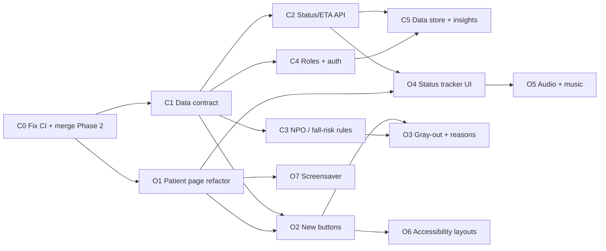

# Team Plan: User Stories Sprint

**Source:** `User Stories.xlsx` (8 stories) · **Team:** Chaitya (C tasks), Om (O tasks)

## The split

- **Chaitya (track A):** backend, data model, staff and admin side.
- **Om (track B):** everything the patient sees and hears.

Splitting this way keeps each person mostly in their own files, which means fewer merge conflicts.

| Story (xlsx) | Priority | Chaitya | Om |
|---|---|---|---|
| US-1 Request storage and data mining | High | C5 | – |
| US-2 "Mirror": request status for the patient | High | C2 (API) | O4 (UI) |
| US-3 Role-based UI split | High | C4 | – |
| US-4 Patient interface customization (accessibility) | Medium | (profile fields in C1) | O6 |
| US-5 Patient status customization (NPO, fall risk) | High | C3 (rules) | O3 (UI) |
| US-6 Request button breakdown (3–4 buttons, emotional needs) | – | (category in C1) | O2 |
| US-7 Waiting music and audio notifications | High | – | O5 |
| US-8 Information screensaver | Low | – | O7 |

## Dependency sequence

**Chaitya's order:** C0 → C1 → C2 → C3 → C4 → C5
**Om's order:** O1 → O2 → O4 → O3 → O5 → O6 → O7

If you're blocked on the other person's task, move to your next unblocked task. You can also build the UI against a mocked API response in a test fixture and wire it up once the real API is merged.

The two tasks that unblock the most work are **C1** and **C2**, so Chaitya should merge them as early as possible.

---

## Step 0: shared base (before anyone branches)

**C0 · Chaitya · blocker**
1. Fix the CI e2e failure on `phase-2-ui`. Scenario (b) "incision throbbing dizzy → Nursing HIGH" fails in CI with `expect(locator).not.toContainText("402")` / element not found. It passes locally. CI run: 38027509779.
2. Merge `phase-2-ui` into `main`, tag `phase-2-complete`, and push.
3. Tell Om, then both of you branch from `main`.

## Sprint 0: foundations (small; merge fast)

**C1 · Chaitya · data contract (backend + TS types)**

Changes to the data model:
- `Room` gets `profile: PatientProfile` with these fields:
  - `npo: bool` and `npo_reason`
  - `fall_risk: bool`
  - `diet`
  - `accessibility { low_vision, speech_difficulty, cannot_write }`
  - `attendant_preference` (`any` / `female` / `male`)
- New `Category.EMOTIONAL_SUPPORT`, routed to **nursing, NORMAL priority** for now. See the open questions below.
- `Ticket` gets three new fields:
  - `severity: int 1–5`, which orders requests inside a department
  - `eta_minutes: int | None`
  - `history: list[StatusChange]`, where each entry has `status`, `at` and `by_role`
- New `Role` enum: `patient`, `nurse`, `housekeeping`, `food`, `it`, `admin`.

Housekeeping so the two tracks don't collide:
- Move `QUICK_TAP_TILES` out of `services.py` into its own `backend/app/tiles.py`. Om then owns the tiles and Chaitya owns `services.py`.
- Mirror all of the above in `frontend/src/types/ticket.ts`.
- `scripts/seed.py` gives demo rooms varied profiles: 410 NPO, 412 fall risk, 414 low vision, 416 speech difficulty, 418 can't write. (Rooms 401–405 belong to the Playwright tests.)

**O1 · Om · patient page refactor, no behavior change**
- Split `frontend/src/pages/PatientPage.tsx` into `frontend/src/components/patient/`: `Header`, `NurseButton`, `InputPanel`, `RequestTiles`, `MyRequests` and `Confirmation`.
- Existing vitest and Playwright tests must still pass unchanged.
- Every later Om task touches only one or two of these files, which keeps merges clean.

## Track A: Chaitya

**C2 · US-2 API · status tracker and ETA**
- Append to `history` on every status transition.
- Compute `eta_minutes` from today's median time-to-acknowledge for that department and priority. Fall back to defaults: HIGH = 2 min, otherwise 10 min.
- Expose `history` and `eta_minutes` in `PatientTicketView`.
- New patient endpoint: `PATCH /api/rooms/{room_id}/tickets/{ticket_id}` with actions `cancel`, `add_note` and `still_waiting`. It publishes `ticket.updated` so the department sees the change, as the story asks.
- **Safety:** a patient action can never lower the priority of a clinical ticket.

**C3 · US-5 rules · NPO and fall risk**
- **NPO:** the server refuses food and drink tiles for NPO rooms and returns a reason code. Free text about food still goes through, routed to nursing with the reason.
- **Fall risk:** a fall-risk room making a bathroom or movement request is raised to HIGH, with safety reason `fall_risk`. The patient gets a templated message saying their request was marked higher priority.
- Add unit tests. `make eval` must still pass the safety gate.

**C4 · US-3 roles and auth**
- Tokens carry a `role`, not just a department. Add an admin login.
- `/admin` requires admin. Staff only see their own department.
- Patients never see staff UI, and staff pages have no patient input.
- Queues sort by severity, then by wait time. This was a mentor request.
- ~~Home page becomes a role picker.~~ Dropped: the home page is the patient screen, and each department and admin has its own URL.

**C5 · US-1 data store and insights**
- Every request is stored with category, severity, history and audit.
- `GET /api/analytics` is open to admin and nurse only. Housekeeping and patient roles get 403. It returns:
  - volume by category, department and hour
  - median time to acknowledge and to resolve
  - escalations
  - top rooms
- Add a CSV export.
- Add charts to the admin page.

## Track B: Om

**O2 · US-6 new buttons**

The main tiles (next to the red nurse button, which always stays):
- **Thirsty** opens a choice of ice or water.
- **Comfort** opens pillow, blanket, temperature or TV.
- **Food & medication** opens a dropdown. Medication goes to **nursing**.
- **Emotional support** opens family, counseling or spiritual.
- **Bathroom** respects `attendant_preference`, if the team approves it.

Files: `backend/app/tiles.py`, the tile component and `strings.ts` (all 7 languages).

**O3 · US-5 UI · gray-out with reasons**
- Disabled tiles come from `room.profile`, e.g. food and water when NPO.
- Tapping a disabled tile shows a simple explanation (and reads it aloud once O5 lands).
- Show a "higher priority" message for fall-risk requests.
- **The nurse button is never disabled.**

**O4 · US-2 UI · the "Mirror" tracker**
- Show each request as a stepper: Sent → Seen → On the way → Done, with an ETA countdown and live updates.
- Add buttons for "Cancel" and "Still waiting?", which call C2's endpoint.
- Keep it simple, as the story says.

**O5 · US-7 audio**
- Speak status updates aloud in the patient's language using `speechSynthesis`. The text must match the on-screen status exactly.
- Optional waiting music starts when a request is sent and stops when it's done.
- Separate on/off toggles for voice and music, remembered per room in localStorage.

**O6 · US-4 accessibility layouts** (driven by `room.profile.accessibility`)
- **Low vision:** extra-large buttons and read-aloud. See the open question below.
- **Speech difficulty:** hide the mic; emphasize buttons and text.
- **Can't write:** hide the text box; buttons and voice only.

**O7 · US-8 screensaver** (taken by Chaitya)
- After 3 minutes idle, fade to info slides. Patient screen only.
- Any touch exits, and the page state is unchanged afterwards.
- If a request is open, keep its status visible on the screensaver.

---

## How we work

### Branches
- Name branches `feat/<task-id>-<slug>`, e.g. `feat/C2-status-api` or `feat/O2-buttons`. Branch from `main`.
- Rebase on `main` at least daily: `git pull --rebase origin main`.

### Pull requests
1. Open a PR to `main`. CI must be green: lint, tests, the eval gate and e2e.
2. The other person reviews it.
3. Squash-merge.

Keep PRs small, one task each. Merge C1 and C2 as soon as they're green.

### File ownership

| Files | Owner |
|---|---|
| `backend/app/models/*`, `frontend/src/types/ticket.ts` | Chaitya. Om asks for changes. |
| `backend/app/tiles.py`, `frontend/src/components/patient/*`, `PatientPage.tsx` | Om |
| `frontend/src/i18n/strings.ts` | Shared. Add keys next to related ones, keep all 7 languages filled in (TypeScript enforces this), and rebase before pushing. |

### Definition of done
- Tests added (pytest and/or vitest).
- `make lint` and `make test` pass.
- Playwright e2e updated if a flow changed.
- New text exists in all 7 languages.

## Safety rules (never break these)
1. Rules and patient actions can only move a request **toward** nursing or higher priority, never down.
2. Anything clinical, unclear, or involving medication goes to **nursing**.
3. The red "I need my nurse" button is always visible and never disabled, whatever the profile, screensaver or layout.
4. `make eval` must keep 100% urgent recall. CI enforces this as a gate.

## Open questions ("Come back to" in the xlsx)
1. **Roles:** add or remove any? The current list is patient, nurse, housekeeping/facilities, food, unit clerk/IT, admin. What about a charge nurse, chaplain, or social worker?
2. **Bathroom attendant gender:** is it practical? Ask the mentor or a nurse.
3. **Button count:** 3 or 4 main tiles, plus the nurse button? O2 currently lists five candidates.
4. **Emotional support routing:** nursing for now, or a new "support" department?
5. **Low vision:** the story says buttons only, with no audio or text. But voice input and read-aloud usually help low-vision users most. Confirm before building O6.
6. **EMR data:** profiles are mocked in the seed data for now. There's no Epic integration in the hackathon scope.

**Not in this sprint:** Phase 3 AWS deployment and the Bedrock eval. They're still blocked on credentials, and whoever gets credentials first takes them.
